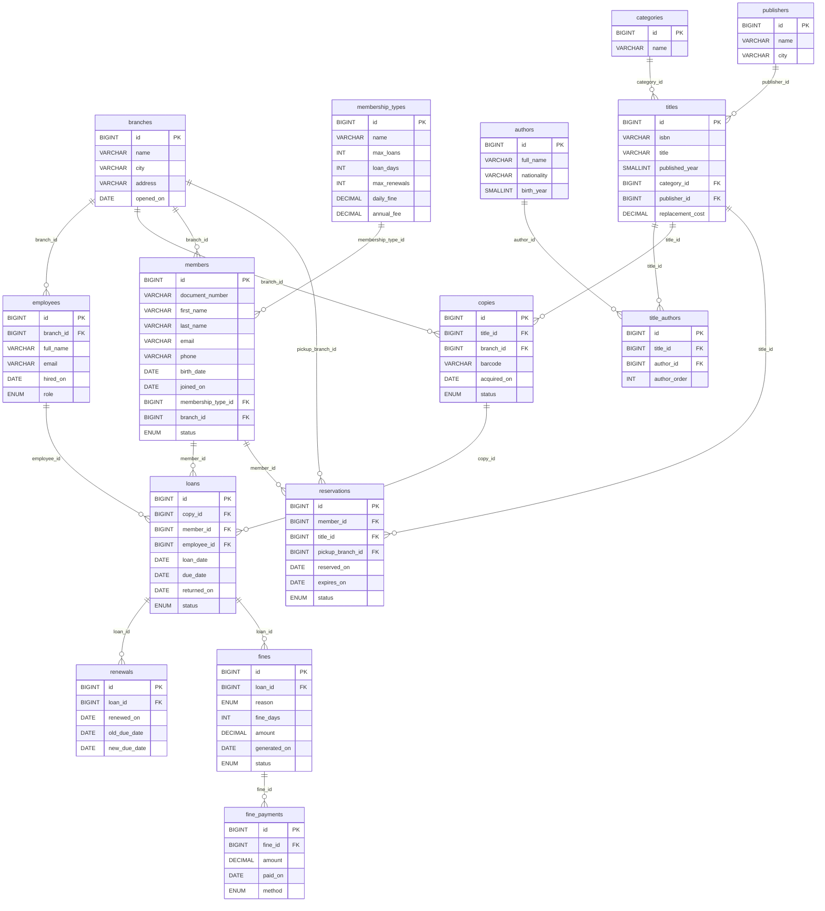

# Fase 1 · BiblioRed · Diagrama entidad-relación

## Diagrama (Mermaid)

Se distinguen **título (obra editorial)** y **ejemplar (objeto físico)**. Los trazos parten de la tabla padre a la hija: `||` significa exactamente uno, `o{` cero a muchos y `o|` cero o uno. La FK de la hija es obligatoria donde está declarada `NOT NULL`; todas las tablas incluyen PK y los atributos exigidos.

## Cardinalidades, participación y decisiones

Cada **sede** (0..N) emplea **empleados** (1..1 cada empleado) y guarda **ejemplares** (1..1 cada ejemplar), pudiendo estar vacía; además afilia **socios** (1..1 cada socio). Cada **categoría** y **editorial** (0..N) cataloga **títulos** (1..1 por título). Un **autor** (0..N) firma **títulos** (1..N autores por obra, representados por `title_authors`, que guarda `author_order`); los pares título-autor son únicos y el puesto de autoría no se repite. Un **título** (0..N) tiene **ejemplares** (1..1 título por ejemplar). Una **membresía** (0..N) agrupa **socios** (1..1 membresía por socio). Un **socio** (0..N) realiza **préstamos** (1..1 socio por préstamo) y **reservas** (1..1 socio por reserva). Un **empleado** (0..N) tramita **préstamos** (1..1 empleado por préstamo). Un **ejemplar** (0..N históricos) participa en **préstamos** (1..1 ejemplar por préstamo); a la vez solo uno puede estar activo, regla de proceso. Un **préstamo** (0..N) tiene **renovaciones** y **multas** (1..1 préstamo por cada renovación o multa). Cada **multa** (0..N) tiene **cuotas** (1..1 multa por cuota). Cada **reserva** (1..1) elige una sede de recogida, que es independiente de la sede del socio.

## Normalización

- **1FN:** guardar `autores = 'Ana, Luis'` en una columna impide consultar el orden por autor; `title_authors` conserva un autor y orden por fila.
- **2FN:** en una tabla combinada título-autor, poner `title` junto a `author_id` depende solo de `title_id`, no de la clave compuesta; `titles` separa atributos de la obra de los de su relación con autores.
- **3FN:** si `members` almacenara `daily_fine`, la tarifa dependería de `membership_type_id`, no del socio; el costo diario se guarda solo en `membership_types`. La multa ya causada conserva `amount` histórico sin recalcularse.
- **4FN:** no hay dependencias multivaluadas independientes que se almacenen juntas: autores, ejemplares, reservas y pagos están separados.

## Respuestas al caso

El título no es el ejemplar: evita repetir ISBN/autores por cada copia. La posición de autoría pertenece al vínculo título-autor. Una subida de tarifa modifica **una membresía**, no cada socio. La multa conserva su valor en `fines.amount` y su socio se obtiene por `fines → loans → members` sin redundancias. `renewals` conserva vencimientos anteriores, las cuotas se suman para hallar el saldo, y la reserva se refiere al título con la sede de recogida elegida.

## Reglas que precisan lógica de negocio

No son protegibles con `CHECK` por requerir otras filas/tablas o cambiar dos registros: vencimiento según membresía, límites de préstamos, morosidad, préstamo↔ejemplar, renovaciones máximas y reservas pendientes, expiración de reservas, generación de multas y abonos máximos/acumulados. Se atienden mediante procedimientos y transacciones, sin funciones propias ni triggers en este taller.
