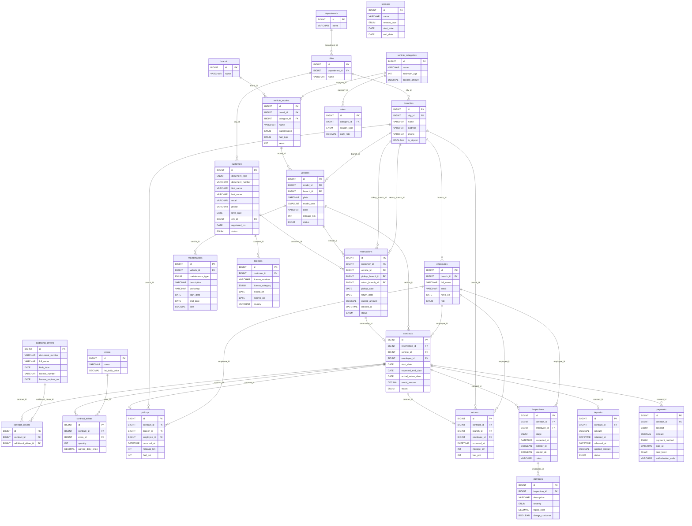

# Fase 1 · FlotaYa · Diagrama entidad-relación

## Diagrama (Mermaid)

`||` = exactamente uno, `o{` = cero a muchos, `o|` = cero o uno. Cada FK de la hija identifica la relación con el padre. Las dobles FK a sede identifican por separado recogida y devolución.

## Cardinalidades y participación

`departments` 0..N `cities`, cada ciudad 1..1 departamento; `cities` 0..N `branches`, cada sede 1..1 ciudad. Cada sede 0..N empleados y vehículos; cada empleado/vehículo 1..1 sede vigente. Una marca 0..N modelos, cada modelo 1..1 marca y 1..1 categoría; categoría 0..N modelos y exactamente 3 tarifas por tipo; una temporada establece un intervalo de un tipo de temporada. Un modelo 0..N vehículos. Un vehículo 0..N reservas históricas, mantenimientos y contratos, cada hijo 1..1 vehículo. Una reserva 1..1 cliente, 1..1 vehículo y 1..1 sede de entrega y 1..1 de devolución; cada reserva 0..1 contrato (`UNIQUE`). Cliente 0..N licencias, cada licencia 1..1 cliente. Contrato 0..N conductores adicionales y extras por puente, 0..1 entrega, 0..1 devolución, 0..2 inspecciones (máximo una por etapa), 1..1 depósito en el caso de negocio, 0..N pagos. Cada inspección 0..N daños y cada daño 1..1 inspección.

Las 1:1 opcionales las limita `UNIQUE(contract_id)` en `pickups`, `returns` y `deposits`, y `UNIQUE(contract_id,stage)` en `inspections`. Cada entrega y devolución apunta también a una sede y empleado propios; no es la sede de afiliación de un cliente.

## Normalización y preguntas guía

- **1FN:** una reserva con `[GPS, silla, seguro]` en una sola celda no es atómica; los extras pactados van en filas de `contract_extras`.
- **2FN:** en una relación contrato-extra, `list_daily_price` depende del extra, no del par; vive en `extras`, mientras `agreed_daily_price` es atributo del vínculo y conserva el precio histórico.
- **3FN:** la edad mínima y depósito dependen de categoría, no de placa ni modelo; separarlos evita actualizaciones múltiples. La tarifa depende de `(category_id, season_type)` y son **6 × 3 = 18** tarifas, no 60 para las diez temporadas.
- **4FN:** conjuntos independientes de conductores, extras, pagos y daños residen en tablas separadas; no combinamos sus múltiples valores en un producto cartesiano.

Reserva y contrato no son la misma cosa: la reserva puede cancelarse sin contrato; `contracts.reservation_id` determina al cliente a través de la reserva. Una renovación de licencia añade otra fila y un conductor adicional puede existir sin ser cliente. Un daño pertenece a `inspections`, cuya `stage` distingue previo de nuevo; los previos se marcan no cobrables. Guardamos `quoted_amount` (histórico), `agreed_daily_price`, `rental_amount` al cierre y datos observados; la edad, noches, tarifa aplicable y saldo se **calculan**.

## Reglas y restricciones entre tablas

| Regla | Estructura | Solución adicional |
|---|---|---|
| 6 | Solo `end_date >= start_date` | Comprobar cobertura y solapamiento del calendario completo |
| 8 | No | `fn_valor_alquiler` recorre cada noche |
| 9 | Fechas y nulidad consistente | Operación coordinada al terminar taller |
| 14 | No | `sp_crear_reserva` busca cruces de reservas vivas |
| 15 | No | Edad y licencia vigentes en procedimiento |
| 20 | Costo/etapa/cobro individual | Validar que un daño previo no sea cobrable |
| 21 | `applied_amount <= amount` | Vincular monto con categoría al abrir contrato |
| 23 | No | Cierre con procedimiento y transacción exterior |

Los procedimientos verifican las reglas al acceder por las rutas previstas. Sin triggers, las escrituras directas con cuenta administrativa pueden eludir validaciones cruzadas; por eso las cuentas de uso diario reciben privilegios mínimos.
